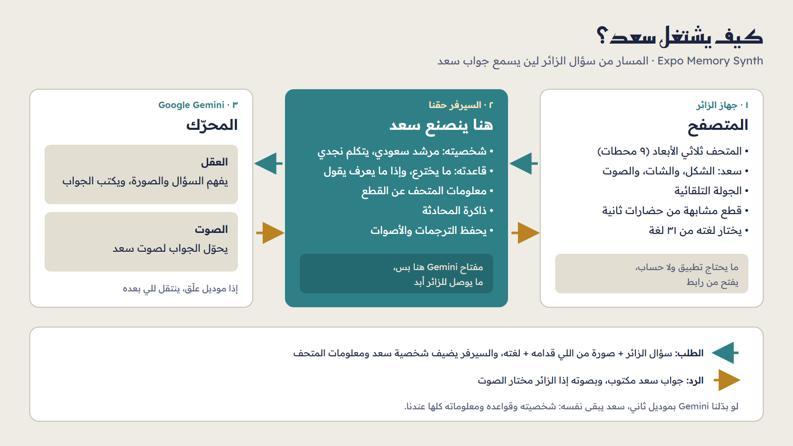

# Expo Memory Synth — شرح المشروع

## الفكرة باختصار
موقع يخلي أي شخص في العالم يزور ركن حقيقي من متحف في الرياض كمشهد ثلاثي الأبعاد، ومعه **سعد**، مرشد سعودي ذكي يشرح ويجاوب بلغة الزائر. واللي زار المكان فعلاً يرفع صوره ويطلع له **فيلم ذكرى يحكيه بصوته هو**.

**المشكلة:** زوار إكسبو ٢٠٣٠ من كل العالم، بس مو الكل يقدر يسافر. والمتاحف أونلاين صور ثابتة، بلغة أو لغتين، وما تربط القطع بحضارة الزائر.

---

## تجربة الزائر

### زائر عن بُعد (`web/index.html`)
1. يختار لغته من **٣١ لغة** لدول الإكسبو.
2. يتجول في **٩ محطات** بالأسهم، أو يضغط «جولة تلقائية» وسعد يحكي عن كل محطة بصوته.
3. بكل محطة تطلع بطاقة **«يشبهه من حضارات ثانية»** فيها قطع مشابهة من مصر ومالي وتركيا وإثيوبيا وغيرها.
4. يضغط على سعد ويسأله **كتابة أو بالصوت**، ويختار هل الرد يكون صوت أو كتابة.

### زائر فعلي (`web/memory.html`)
1. يرفع صور رحلته، فيطلع له المقطع الجاهز للمتحف.
2. يكتب قصته، أو يعدّل القصة المقترحة.
3. يوافق، ويسجّل صوته ١٥ ثانية، فتنقرأ قصته بصوته المستنسخ.
4. يطلع له فيلم (MP4) فيه المقطع وصوته وترجمة مكتوبة، ويقدر ينزّله.

> فيه صفحة ثانية `film.html` تسوي فيلم من صور الزائر نفسها، بحركة 3D وقصة مكتوبة بالذكاء الاصطناعي، وتنقرأ بصوت سعد أو بصوت الزائر.

---

## كيف يشتغل


| الجزء | وش يسوي | التقنية |
|---|---|---|
| المشهد 3D | فيديو جوال يتحوّل لمتحف ثلاثي الأبعاد | Gaussian Splatting: COLMAP + gsplat (MCMC) على Kaggle |
| العرض | يعرض المشهد في المتصفح على الجوال والكمبيوتر | GaussianSplats3D + three.js |
| عقل سعد | يفهم السؤال + صورة اللي قدام الزائر، ويجاوب | Google Gemini (مع موديلات احتياطية) |
| صوت سعد | صوت رجالي طبيعي، نجدي بالعربي، ونفس الصوت بكل اللغات | Gemini TTS، و edge-tts احتياطي |
| صوت الزائر | يقرأ القصة بصوت الزائر، على جهازنا | XTTS-v2 (`voice_clone.py`) |
| السيرفر | يخبي المفاتيح، ويضيف شخصية سعد ومعلومات المتحف | Python بدون مكتبات خارجية |

**كيف ينصنع سعد:** الصفحة ترسل سؤال الزائر مع صورة من المنظر ولغته. السيرفر يضيف عليها شخصية سعد وقواعده ومعلومات المتحف من `guide.json`، ويرسلها لـ Gemini، والجواب يرجع مكتوب أو بصوت سعد.

**قاعدة سعد:** أي معلومة عن قطعة لازم تكون من ملاحظات الفريق أو من لوحة يشوفها في المنظر. إذا ما يعرف يقول «ما أعرف».

**الجولة:** كلام المحطات مسجّل مسبقاً بصوت سعد للعربي. للغات الثانية يترجمه السيرفر مرة وحدة ويحفظ الترجمة، والصفحة تجهّز صوت المحطة الجاية قبل ما توصلها.

---

## أهم الملفات
| الملف | وظيفته |
|---|---|
| `web/index.html` | الجولة ثلاثية الأبعاد |
| `web/tour.js` | المحطات والجولة التلقائية |
| `web/guide.js` | سعد (الشات، والصوت أو الكتابة) |
| `web/voice.js` | تشغيل الأصوات |
| `web/languages.js` | قائمة اللغات وترحيب سعد بكل لغة |
| `web/culture.js` | بطاقات الحضارات |
| `web/memory.html` | فيلم الذكرى بصوت الزائر |
| `web/film.html`, `film*.js` | فيلم من صور الزائر |
| `web/scenes/corner/` | ملفات المشهد والمحطات والقصة والأصوات |
| `scripts/server.py` | السيرفر وكل روابط الـ API |
| `scripts/tts.py` | صوت سعد |
| `scripts/voice_clone.py` | استنساخ صوت الزائر |
| `scripts/make_audio.py` | تسجيل مقاطع الجولة |
| `notebooks/` | تدريب المشهد 3D على Kaggle وColab |
| `docs/` | صور الأركتكتشر والفلو، وهذا الملف |
| `promo/` | المقطع التسويقي (٤٨ ثانية) |

---

## التشغيل على الجهاز
١. حطي المفتاح في ملف `.env` بمجلد المشروع: `GEMINI_API_KEY=...`

٢. شغّلي السيرفر:
```bash
python scripts/server.py
```

٣. شغّلي خدمة صوت الزائر، في نافذة ثانية:
```bash
.venv-voice\Scripts\python scripts/voice_clone.py
```

٤. افتحي الصفحات:
- الجولة: `http://localhost:8000`
- فيلم الصوت: `http://localhost:8000/memory.html`

---

## الخصوصية والأمانة
- صور الزائر وصوته ما تنستخدم إلا بموافقة صريحة.
- عينة الصوت تنحذف أول ما يطلع الفيلم.
- المفاتيح على السيرفر بس، ما تطلع للصفحة.
- الصور المشابهة من ويكيميديا كومنز، وكل صورة تفتح مصدرها ورخصتها.
- تحت اسم سعد مكتوب «معلومات تجريبية» لين نستلم النصوص الرسمية من المتحف.

## الحدود الحالية
- المسح يتغبش بالأماكن اللي ما انصورت زين.
- حصة الصوت المجانية ١٠ مقاطع باليوم لكل موديل. ليوم العرض الأفضل مفتاح مدفوع.
- أزرار الموقع عربي وإنجليزي بس، أما سعد فيتكلم الـ ٣١ لغة كلها.
- استنساخ الصوت يحتاج جهاز يشغّله، ورخصته للاستخدام غير التجاري.
- مقطع فيلم الذكرى ثابت، ما يتولّد من صور الزائر.

## الجاهز للعرض
- **المقطع التسويقي:** `promo/expo-memory-synth-promo.mp4`
- **صور الأركتكتشر وفلو الصفحات لفريق الـ UX:** `docs/architecture.png` و `docs/user-flow.png`
- **عرض Canva:** معبّى، وباقي فيه المسار في شريحة ٩، والفيديو في شريحة ١٢، ولون نصّين في شريحة ١٣.

## الخطوات الجاية
1. النشر برابط عام، على Hugging Face Spaces مثلاً.
2. دمج تصاميم فريق الـ UX: الرئيسية، والحساب، وقائمة الأجنحة.
3. معلومات رسمية من المتحف بدل النصوص التجريبية.
4. أجنحة أكثر، وحساب يحفظ أفلام الزائر.
